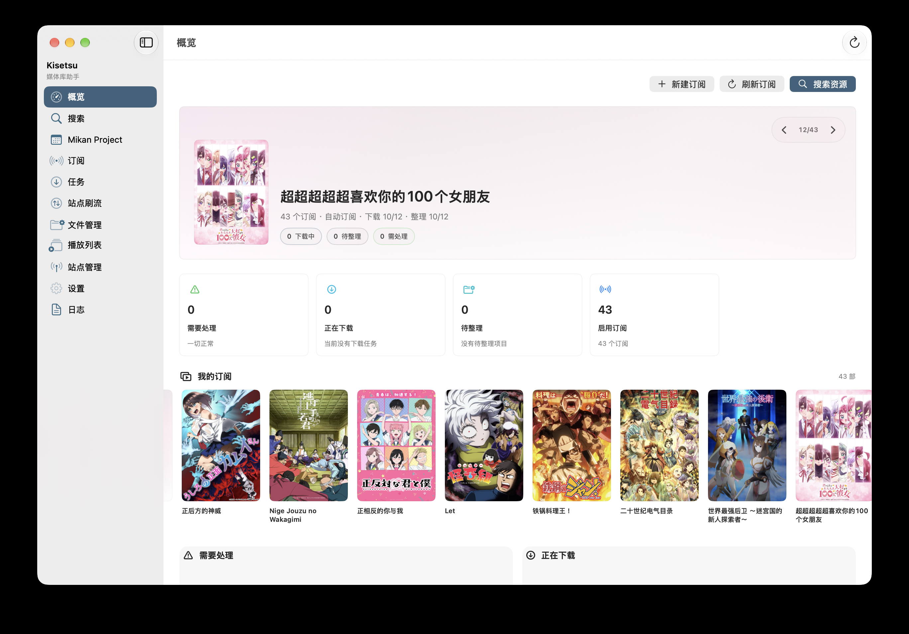
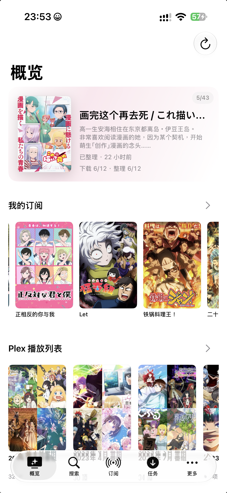
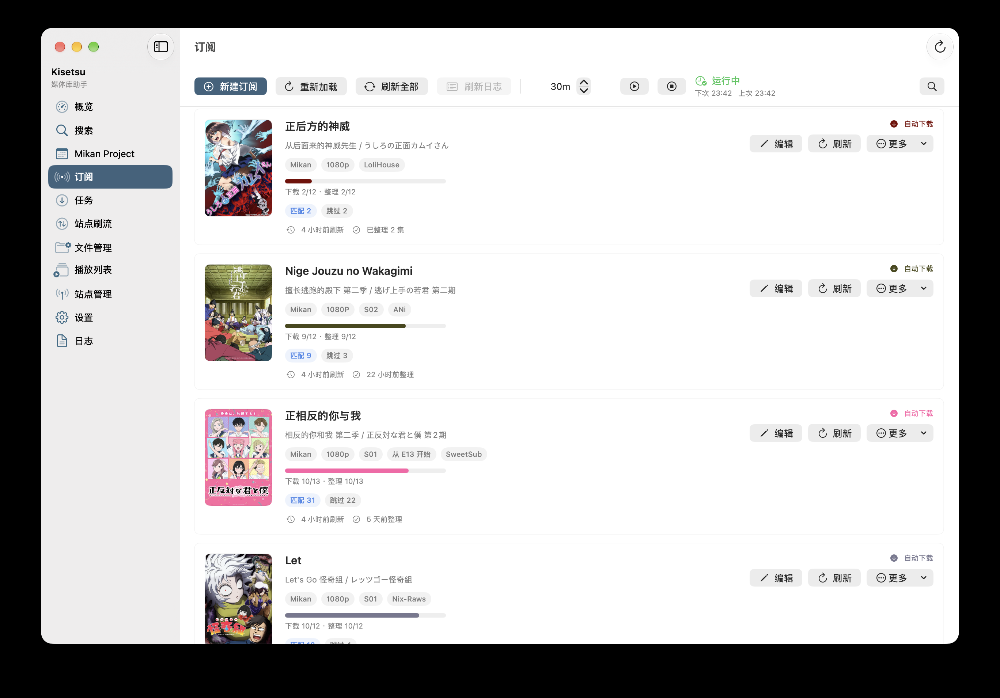
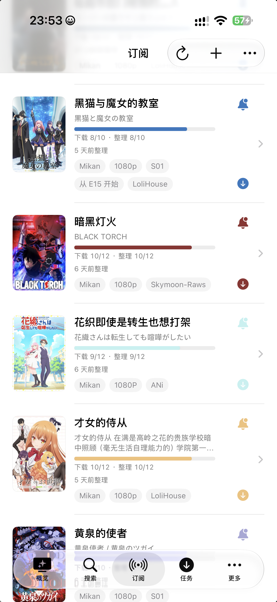

<p align="center">
  
</p>

<h1 align="center">Kisetsu</h1>

<p align="center">
  自托管的动画订阅与媒体整理工作台<br>
  在 macOS 和 iPhone 上掌握追番进度、下载任务与 Plex 播放列表
</p>

<p align="center">
  <picture><source media="(prefers-color-scheme: dark)" srcset="docs/icons/apple-dark.svg"></picture> macOS
  &nbsp;&nbsp;
   iPhone
  &nbsp;&nbsp;
   FastAPI
  &nbsp;&nbsp;
   Plex
</p>

<p align="center">
  <a href="https://github.com/MIAONECYAN/Kisetsu/releases/latest"><strong>下载最新版本</strong></a>
  &nbsp;&nbsp;·&nbsp;&nbsp;
  <a href="#快速开始">部署与构建</a>
  &nbsp;&nbsp;·&nbsp;&nbsp;
  <a href="NOTICE.md">使用须知</a>
</p>

Kisetsu 将资源搜索、订阅跟踪、下载与整理、媒体识别和 Plex 播放列表放在同一套工作流里。自托管后端为 macOS 与 iPhone 客户端提供服务；资源、凭证和媒体文件由你自己管理。

> [!IMPORTANT]
> Kisetsu 是采用 [MIT License](LICENSE) 发布的开源软件。Kisetsu 不提供媒体内容、
> 站点账号或第三方服务；使用者应自行确保数据来源和使用行为合法，并在使用前阅读
> [NOTICE.md](NOTICE.md)。

## 核心能力

### 番组订阅与分组

- **建立订阅：** 在 Mikan Project 浏览当季番组和字幕组资源，并从选中的资源建立订阅；也支持关键词、Mikan 番组地址和 RSS。
- **收窄匹配：** 按字幕组、分辨率、集数范围或正则表达式筛选资源。
- **管理列表：** 为订阅分组，并结合搜索与“订阅完成”状态筛选。

### 进度与持续追更

- **概览与进度：** 查看订阅焦点、下载任务、待整理任务和最近整理。“订阅完成”依据目标范围内的下载与整理结果判定。
- **总集数更新：** 新建订阅默认开启自动更新；刷新时依据可靠元数据维护总集数。配置并启用 Bark 后，集数增加可收到变更前后的集数通知。

### 搜索、下载与整理

- **资源搜索：** 覆盖 DMHY、Mikan、Nyaa、Anime Garden 和已配置的 PT 站点。
- **下载与整理：** 连接 qBittorrent 或 Transmission；借助 Bangumi/TMDB 元数据识别并整理单集、多集、合集与电影。
- **其他工具：** 站点刷流和文件管理各有独立入口。

### Plex 播放列表

- **查看列表：** 在概览和播放列表页浏览已有的 Plex 播放列表。
- **创建清单：** 按季度番组数据关联 Plex 节目，选择剧集并预览；确认后创建视频播放列表，不改动已有列表或媒体文件。

站点、下载器、元数据服务以及可选的 Plex、Bark 均需由使用者自行配置。

## 界面

macOS 与 iPhone 各两张截图，点击可查看原图。

<table>
  <tr><th align="center">macOS · 概览</th><th align="center">iPhone · 概览</th></tr>
  <tr>
    <td align="center" width="72%"><a href="docs/screenshots/macos-overview.png"></a></td>
    <td align="center" width="28%"><a href="docs/screenshots/iphone-overview.png"></a></td>
  </tr>
  <tr><th align="center">macOS · 订阅</th><th align="center">iPhone · 订阅</th></tr>
  <tr>
    <td align="center"><a href="docs/screenshots/macos-subscriptions.png"></a></td>
    <td align="center"><a href="docs/screenshots/iphone-subscriptions.png"></a></td>
  </tr>
</table>

## 获取版本

从 [GitHub Releases](https://github.com/MIAONECYAN/Kisetsu/releases/latest) 下载**同一版本**的后端与客户端；新功能可能需要对应版本的后端。

| 下载内容 | 说明 |
| --- | --- |
| 后端源码包 | Python 3.11+；包内目录为 `Kisetsu/backend`，不包含仓库的启动脚本 |
| macOS 客户端 | macOS 15+、Apple Silicon；ad-hoc 签名，未经 Apple 公证 |
| iPhone 客户端 | `arm64` 未签名 IPA，ZIP 内保留原名 `Kisetsu.ipa`；安装前需自行签名 |
| `SHA256SUMS.txt` | 校验上述三个发布附件 |

### LiveContainer 订阅源

在 LiveContainer 的 **Sources** 页面添加以下地址，即可从 Source 下载 iPhone 版：

```text
https://raw.githubusercontent.com/MIAONECYAN/Kisetsu/main/LiveContainer/source.json
```

该订阅源直接读取仓库中的 [`Kisetsu.ipa`](LiveContainer/Kisetsu.ipa)，与 Release 中供手动下载的 ZIP 并存。IPA 未签名，使用前仍需按 LiveContainer 的要求配置签名。

> 发布 iPhone 新版本时，需同步更新 IPA 和 [`source.json`](LiveContainer/source.json) 中的版本、大小与日期；订阅源不会自动跟随 Release 更新。

## 快速开始

下面的命令基于完整源码仓库。Release 中的后端包只有 `backend/`，不含这里使用的 `script/` 和 `.env.example`。

### 运行自托管后端

需要 Python 3.11 或更高版本：

```bash
git clone https://github.com/MIAONECYAN/Kisetsu.git
cd Kisetsu

python3 -m venv .venv
source .venv/bin/activate
python3 -m pip install -e ./backend
cp .env.example .env
set -a
source .env
set +a
./script/start_backend.sh
```

> [!NOTE]
> 自托管后端目前仅在 macOS 上完成运行与回归测试。Linux、Windows、NAS、容器及
> 其他平台需要使用者自行测试兼容性并承担相应风险。

在另一台设备上连接后端前，需要将监听地址及网络访问配置为该设备可以到达的地址；默认的 `127.0.0.1` 仅供本机访问。

### macOS 客户端

需要 macOS 15 或更高版本：

```bash
./script/build_and_run.sh
```

### iPhone 客户端

使用 Xcode 27 和 iOS 27 SDK，在仓库根目录运行：

```bash
./script/build_mobile_ipa.sh
```

输出为 `dist/Kisetsu.ipa`。该文件是 `arm64` 未签名包，安装前必须使用自己的开发者
证书签名。首次启动后，在客户端设置中填写设备可以访问的自托管后端地址。

## 配置与数据

`.env.example` 是配置模板。运行时凭证应写入未跟踪的 `.env`，或通过客户端设置页保存。

站点、通知、AI 与 Plex 认证资料存放于独立的 `kisetsu-secrets.sqlite3`。它采用权限隔离存储，**不是加密保险库**。

不要提交或分享以下内容：

- `.env`、Token、Cookie、API Key 与签名材料。
- `data/`、SQLite 数据库及其 WAL/SHM 文件。
- 日志、备份、媒体路径和带有真实任务信息的截图。

## 项目结构

```text
AppleClient/   macOS 与 iPhone SwiftUI 客户端
backend/       FastAPI 自托管后端
script/        启动、构建与打包脚本
```

## AI 编写声明

**本仓库中的代码由 AI 工具完整生成；需求定义、审核、测试和发布由项目维护者负责。**

公开源码不代表代码没有缺陷。使用者应自行审查其安全性、兼容性与适用性。

## 许可与免责声明

源码采用 [MIT License](LICENSE)，允许在保留版权与许可声明的前提下使用、复制、
修改、合并、发布、分发、再许可及销售软件副本。

软件按现状提供。维护者不对数据丢失、下载或整理结果、版权争议、账号封禁、服务中断
及其他使用后果承担责任。使用者应自行确认数据来源及使用行为符合所在地法律与第三方
服务条款。

完整使用说明与免责声明见 [NOTICE.md](NOTICE.md)；第三方项目与商标说明见
[THIRD_PARTY_NOTICES.md](THIRD_PARTY_NOTICES.md)。
